# Low Level Design: Shore Excursions Application Modernization

## 1. Document Control
- **Version:** 1.0 (Draft for Review)
- **Source:** User Stories US-001 through US-063
- **Tech Stack:** React 18+ (TypeScript) | Java 21 + Spring Boot 3.x | PostgreSQL 15+
- **Build Tools:** Maven, Flyway, MapStruct, Lombok, springdoc-openapi
- **Date:** 2025-07-10

---

## 2. Overview

**Purpose and Scope:**
This document provides the low-level design for the Shore Excursions Application Modernization project. The system replaces a legacy IBM Domino-based application with a modern, cloud-ready, React + Spring Boot + PostgreSQL stack. It supports full CRUD management of cruise port and tour records, RESTful API access for system integrators, role-based access control (RBAC), audit logging, and a responsive UI for content managers, tour operators, and customers.

**Actors / Roles:**
| Role | Description |
|---|---|
| `db_admin` | Full CRUD on all entities; user management; audit log access; system config |
| `editor` | Create, read, update ports and tours; manage images; no delete, no user management |
| `user` | Submit requests; read-only on ports and tours; view own request status |
| `viewer` | Read-only access to ports and tours; no create/update/delete |
| `system_integrator` | External system consuming REST APIs (authenticated service account) |

**Out of Scope / Deferred:**
- Booking/reservation engine (no booking story exists)
- Payment processing
- Customer-facing public portal (stories describe authenticated internal/integrator use)
- Distributed caching infrastructure (US-054 deferred — no cache library added; HTTP-level caching headers applied instead; see A-07)
- Cloud infrastructure provisioning scripts (US-059, US-062 — infrastructure-as-code is a DevOps concern outside application LLD)
- CI/CD pipeline implementation (US-061 — pipeline config is outside application code scope)
- Automated backup orchestration (US-057 — handled by cloud DB service, not application code)
- Email notification service (US-023 — deferred; see A-08)
- Workflow/approver assignment engine (US-022 — deferred; see A-09)
- Amount validation business rule (US-021 — deferred; see A-10)

---

## 3. Assumptions and Open Questions

| ID | Type | Description | Impact | Related US |
|----|------|-------------|--------|------------|
| A-01 | Assumption | Authentication uses JWT (stateless Bearer tokens) stored in `localStorage` on the client. Session timeout is 8 hours (design default). | Drives Spring Security config and React auth state | US-037, US-043 |
| A-02 | Assumption | Password policy (design default): minimum 12 characters, at least 1 uppercase, 1 lowercase, 1 digit, 1 special character. Bcrypt (strength 12) used for hashing. | US-037, US-046 |
| A-03 | Assumption | Port `code` is a short alphanumeric string (max 10 chars, uppercase). Tour `tourId` is a system-generated UUID. | Data model | US-001, US-005, US-024, US-025 |
| A-04 | Assumption | Images are stored as URLs/references (e.g., object storage path) in the database, not as binary BLOBs. An image upload endpoint accepts multipart/form-data and returns a stored URL. | US-031 |
| A-05 | Assumption | Pagination default page size is 20 records; maximum is 100 (design default). | US-009, US-011, US-015 |
| A-06 | Assumption | Audit trail is implemented via `created_at`, `updated_at`, `created_by`, `updated_by` columns on all mutable tables plus a dedicated `audit_log` table for delete events. | US-045 |
| A-07 | Assumption | Caching (US-054) is deferred to a future iteration. HTTP `Cache-Control` headers are applied on GET endpoints as a lightweight alternative. No Redis or external cache is introduced. | US-054 |
| A-08 | Assumption | Email notifications (US-023) are deferred. The approver assignment workflow (US-022) is also deferred as no workflow engine is in scope. A stub service interface is defined to allow future implementation. | US-022, US-023 |
| A-09 | Assumption | US-021 (amount > 0 validation) and US-022 (approver assignment) reference a generic request/approval workflow not described elsewhere in the stories. These are deferred; no `Request` entity is modeled in this iteration. | US-021, US-022 |
| A-10 | Assumption | Record-level security (US-044) means: `viewer` and `user` roles see all ports/tours (read-only); `editor` can edit any port/tour (not ownership-scoped); `db_admin` has full access. Ownership-based row filtering is not implemented in v1. | US-044 |
| A-11 | Assumption | Data migration (US-047) and legacy role mapping (US-048) are represented as Flyway seed scripts and a documented mapping table. Actual ETL tooling is out of scope. | US-047, US-048 |
| A-12 | Assumption | `activity_level` is an enum: `LOW`, `MODERATE`, `HIGH`, `EXTREME`. `category` for tours is a free-text string (max 100 chars) with a predefined list enforced via UI dropdown. | US-005, US-030 |
| A-13 | Assumption | SSL/TLS termination (US-063) occurs at the load balancer/reverse proxy layer. The Spring Boot application runs on HTTP internally. | US-063 |
| A-14 | Assumption | Containerization (US-060) means a `Dockerfile` is provided for the Spring Boot app and the React app. Kubernetes/ECS manifests are out of scope for this LLD. | US-060 |
| Q-01 | Open Question | Should `port_code` be user-entered or system-generated? Current assumption: user-entered (max 10 chars). | Data model, validation | US-001, US-024 |
| Q-02 | Open Question | What is the maximum number of images per port/tour? Assumed: 10 (design default). | US-031 |
| Q-03 | Open Question | Are there specific regions defined (enum) or is region a free-text field? Assumed: free-text (max 100 chars) with a suggested list in UI. | US-001, US-009 |
| Q-04 | Open Question | Should deleted ports/tours be soft-deleted (archived) or hard-deleted? Assumed: hard-delete with audit log entry. | US-004, US-008, US-045 |
| Q-05 | Open Question | What identity provider (IdP) is used? Assumed: local database authentication for v1. SSO/SAML/OIDC integration is deferred. | US-037 |
| Q-06 | Open Question | What is the target cloud provider (AWS, Azure, GCP)? Impacts object storage choice for images. Assumed: provider-agnostic; image storage URL is configurable via environment variable. | US-031, US-059 |

---

## 4. Architecture Overview

### Layered Architecture
The system follows a **Modular Monolith with Layered Architecture**:
- **Presentation Layer:** React 18 SPA (TypeScript) — handles UI rendering, routing, form validation, and API calls.
- **API Layer:** Spring Boot REST Controllers — exposes versioned REST endpoints, handles HTTP concerns, delegates to services.
- **Service Layer:** Spring `@Service` beans — enforces business rules, orchestrates repositories, manages transactions.
- **Repository Layer:** Spring Data JPA repositories — data access abstraction over PostgreSQL.
- **Domain Layer:** JPA `@Entity` classes — represents the database schema.
- **Security Layer:** Spring Security — JWT authentication, role-based authorization.
- **Database:** PostgreSQL 15+ with Flyway migrations.

### Component Diagram

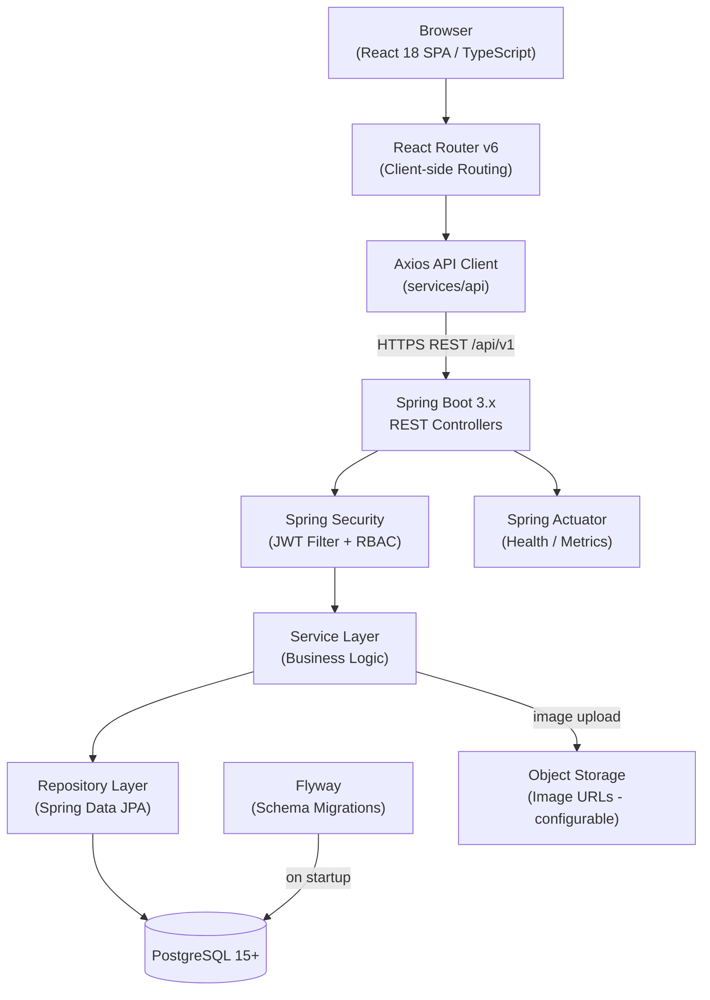

### Key Design Decisions

| Decision | Rationale | Alternatives Rejected |
|---|---|---|
| Modular Monolith | Stories do not require independent scaling of components; simpler ops | Microservices — over-engineered for scope |
| JWT (stateless) authentication | Supports horizontal scaling; no server-side session store needed | HTTP Sessions — requires sticky sessions or shared store |
| MapStruct for DTO mapping | Compile-time, type-safe, no reflection overhead | ModelMapper — runtime reflection, slower |
| Flyway for DB migrations | Version-controlled, repeatable schema changes | Liquibase — heavier XML syntax; Flyway SQL-first fits team |
| Repository Pattern (Spring Data JPA) | Decouples data access from business logic; testable with Testcontainers | Native JDBC — verbose, error-prone |
| Service Layer Pattern | Enforces transaction boundaries and business rules outside controllers | Fat controllers — violates SRP |
| DTO Pattern | Prevents entity exposure in APIs; controls serialization | Direct entity serialization — leaks internal model, causes lazy-load issues |
| Strategy Pattern (role permissions) | Cleanly separates permission logic per role | Hardcoded if/else in controllers — unmaintainable |
| Builder Pattern (via Lombok @Builder) | Readable, immutable DTO construction | Telescoping constructors — error-prone |

---

## 5. Data Design

### 5.1 ER Diagram

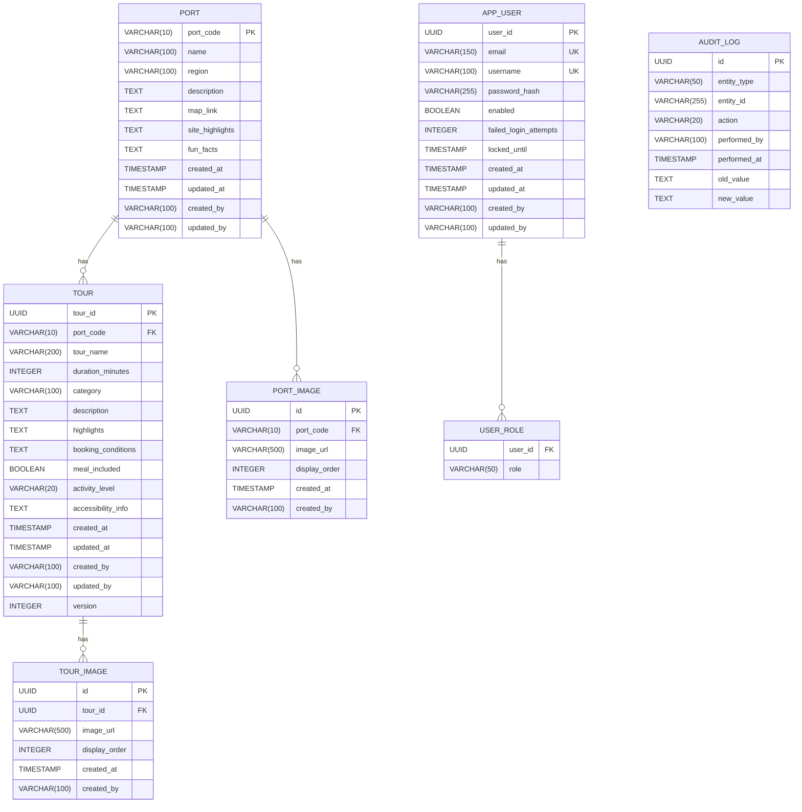

### 5.2 Table Specifications

#### Table: `port`
**Purpose:** Stores shore excursion port/destination records.

| Column | PostgreSQL Type | Nullable | Default | Constraints |
|--------|----------------|----------|---------|-------------|
| `port_code` | `VARCHAR(10)` | NOT NULL | — | PK, uppercase alphanumeric |
| `name` | `VARCHAR(100)` | NOT NULL | — | — |
| `region` | `VARCHAR(100)` | NOT NULL | — | — |
| `description` | `TEXT` | NULL | — | — |
| `map_link` | `TEXT` | NULL | — | — |
| `site_highlights` | `TEXT` | NULL | — | — |
| `fun_facts` | `TEXT` | NULL | — | — |
| `created_at` | `TIMESTAMP WITH TIME ZONE` | NOT NULL | `NOW()` | — |
| `updated_at` | `TIMESTAMP WITH TIME ZONE` | NOT NULL | `NOW()` | — |
| `created_by` | `VARCHAR(100)` | NOT NULL | — | — |
| `updated_by` | `VARCHAR(100)` | NOT NULL | — | — |

- **Primary Key:** `port_code`
- **Unique Constraints:** `port_code` (PK is unique)
- **Indexes:** PK index on `port_code`; index on `region` (for filtering)
- **Foreign Keys:** None
- **Audit Columns:** `created_at`, `updated_at`, `created_by`, `updated_by`

---

#### Table: `tour`
**Purpose:** Stores shore excursion tour records associated with ports.

| Column | PostgreSQL Type | Nullable | Default | Constraints |
|--------|----------------|----------|---------|-------------|
| `tour_id` | `UUID` | NOT NULL | `gen_random_uuid()` | PK |
| `port_code` | `VARCHAR(10)` | NOT NULL | — | FK → `port(port_code)` ON DELETE RESTRICT |
| `tour_name` | `VARCHAR(200)` | NOT NULL | — | — |
| `duration_minutes` | `INTEGER` | NULL | — | CHECK > 0 |
| `category` | `VARCHAR(100)` | NULL | — | — |
| `description` | `TEXT` | NULL | — | — |
| `highlights` | `TEXT` | NULL | — | — |
| `booking_conditions` | `TEXT` | NULL | — | — |
| `meal_included` | `BOOLEAN` | NOT NULL | `FALSE` | — |
| `activity_level` | `VARCHAR(20)` | NULL | — | CHECK IN ('LOW','MODERATE','HIGH','EXTREME') |
| `accessibility_info` | `TEXT` | NULL | — | — |
| `created_at` | `TIMESTAMP WITH TIME ZONE` | NOT NULL | `NOW()` | — |
| `updated_at` | `TIMESTAMP WITH TIME ZONE` | NOT NULL | `NOW()` | — |
| `created_by` | `VARCHAR(100)` | NOT NULL | — | — |
| `updated_by` | `VARCHAR(100)` | NOT NULL | — | — |
| `version` | `INTEGER` | NOT NULL | `0` | Optimistic locking |

- **Primary Key:** `tour_id`
- **Foreign Keys:** `port_code` → `port(port_code)` ON DELETE RESTRICT
- **Indexes:** PK on `tour_id`; index on `port_code` (FK lookup); index on `category`; index on `activity_level`
- **Audit Columns:** `created_at`, `updated_at`, `created_by`, `updated_by`
- **Optimistic Locking:** `version` column

---

#### Table: `port_image`
**Purpose:** Stores image URLs associated with a port.

| Column | PostgreSQL Type | Nullable | Default | Constraints |
|--------|----------------|----------|---------|-------------|
| `id` | `UUID` | NOT NULL | `gen_random_uuid()` | PK |
| `port_code` | `VARCHAR(10)` | NOT NULL | — | FK → `port(port_code)` ON DELETE CASCADE |
| `image_url` | `VARCHAR(500)` | NOT NULL | — | — |
| `display_order` | `INTEGER` | NOT NULL | `0` | — |
| `created_at` | `TIMESTAMP WITH TIME ZONE` | NOT NULL | `NOW()` | — |
| `created_by` | `VARCHAR(100)` | NOT NULL | — | — |

- **Primary Key:** `id`
- **Foreign Keys:** `port_code` → `port(port_code)` ON DELETE CASCADE
- **Indexes:** Index on `port_code`

---

#### Table: `tour_image`
**Purpose:** Stores image URLs associated with a tour.

| Column | PostgreSQL Type | Nullable | Default | Constraints |
|--------|----------------|----------|---------|-------------|
| `id` | `UUID` | NOT NULL | `gen_random_uuid()` | PK |
| `tour_id` | `UUID` | NOT NULL | — | FK → `tour(tour_id)` ON DELETE CASCADE |
| `image_url` | `VARCHAR(500)` | NOT NULL | — | — |
| `display_order` | `INTEGER` | NOT NULL | `0` | — |
| `created_at` | `TIMESTAMP WITH TIME ZONE` | NOT NULL | `NOW()` | — |
| `created_by` | `VARCHAR(100)` | NOT NULL | — | — |

- **Primary Key:** `id`
- **Foreign Keys:** `tour_id` → `tour(tour_id)` ON DELETE CASCADE
- **Indexes:** Index on `tour_id`

---

#### Table: `app_user`
**Purpose:** Stores application user accounts.

| Column | PostgreSQL Type | Nullable | Default | Constraints |
|--------|----------------|----------|---------|-------------|
| `user_id` | `UUID` | NOT NULL | `gen_random_uuid()` | PK |
| `email` | `VARCHAR(150)` | NOT NULL | — | UK |
| `username` | `VARCHAR(100)` | NOT NULL | — | UK |
| `password_hash` | `VARCHAR(255)` | NOT NULL | — | — |
| `enabled` | `BOOLEAN` | NOT NULL | `TRUE` | — |
| `failed_login_attempts` | `INTEGER` | NOT NULL | `0` | — |
| `locked_until` | `TIMESTAMP WITH TIME ZONE` | NULL | — | — |
| `created_at` | `TIMESTAMP WITH TIME ZONE` | NOT NULL | `NOW()` | — |
| `updated_at` | `TIMESTAMP WITH TIME ZONE` | NOT NULL | `NOW()` | — |
| `created_by` | `VARCHAR(100)` | NOT NULL | — | — |
| `updated_by` | `VARCHAR(100)` | NOT NULL | — | — |

- **Primary Key:** `user_id`
- **Unique Constraints:** `email`, `username`
- **Indexes:** UK indexes on `email` and `username`

---

#### Table: `user_role`
**Purpose:** Maps users to their assigned roles (many-to-many via composite key).

| Column | PostgreSQL Type | Nullable | Default | Constraints |
|--------|----------------|----------|---------|-------------|
| `user_id` | `UUID` | NOT NULL | — | FK → `app_user(user_id)` ON DELETE CASCADE |
| `role` | `VARCHAR(50)` | NOT NULL | — | CHECK IN ('ROLE_DB_ADMIN','ROLE_EDITOR','ROLE_USER','ROLE_VIEWER') |

- **Primary Key:** Composite (`user_id`, `role`)
- **Foreign Keys:** `user_id` → `app_user(user_id)` ON DELETE CASCADE

---

#### Table: `audit_log`
**Purpose:** Immutable audit trail of all create/update/delete operations and login events.

| Column | PostgreSQL Type | Nullable | Default | Constraints |
|--------|----------------|----------|---------|-------------|
| `id` | `UUID` | NOT NULL | `gen_random_uuid()` | PK |
| `entity_type` | `VARCHAR(50)` | NOT NULL | — | e.g., 'PORT', 'TOUR', 'APP_USER' |
| `entity_id` | `VARCHAR(255)` | NOT NULL | — | — |
| `action` | `VARCHAR(20)` | NOT NULL | — | CHECK IN ('CREATE','UPDATE','DELETE','LOGIN','LOGIN_FAILED','LOGOUT') |
| `performed_by` | `VARCHAR(100)` | NOT NULL | — | — |
| `performed_at` | `TIMESTAMP WITH TIME ZONE` | NOT NULL | `NOW()` | — |
| `old_value` | `TEXT` | NULL | — | JSON snapshot |
| `new_value` | `TEXT` | NULL | — | JSON snapshot |

- **Primary Key:** `id`
- **Indexes:** Index on `entity_type`, `entity_id`; index on `performed_by`; index on `performed_at`
- **Note:** No UPDATE or DELETE allowed on this table (enforced via DB-level trigger or application policy).

---

### 5.3 Reference/Enum Data and State Machines

#### Enumerations

| Enum | Values | Used In |
|------|--------|---------|
| `ActivityLevel` | `LOW`, `MODERATE`, `HIGH`, `EXTREME` | `tour.activity_level` |
| `UserRole` | `ROLE_DB_ADMIN`, `ROLE_EDITOR`, `ROLE_USER`, `ROLE_VIEWER` | `user_role.role` |
| `AuditAction` | `CREATE`, `UPDATE`, `DELETE`, `LOGIN`, `LOGIN_FAILED`, `LOGOUT` | `audit_log.action` |

#### Seed Data (Flyway)
- Default `db_admin` user created on first deployment (credentials via environment variables).
- Legacy role mapping: `[SHXDbAdmin]` → `ROLE_DB_ADMIN`, `[SHXEditor]` → `ROLE_EDITOR`.

#### State Machine: User Account

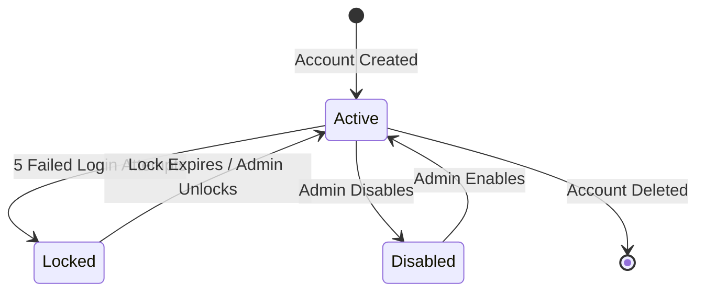

#### State Machine: Port Record

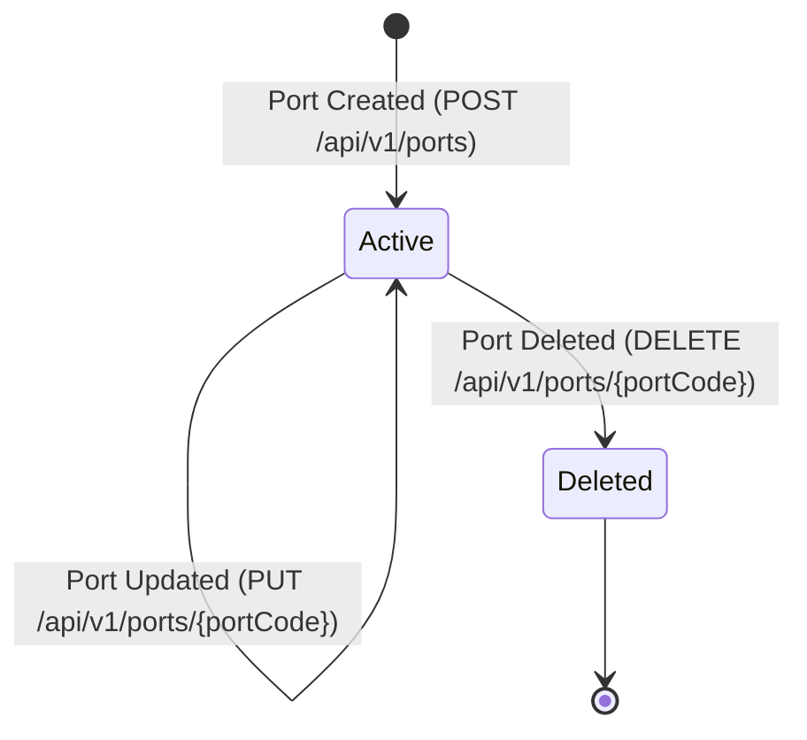

#### State Machine: Tour Record

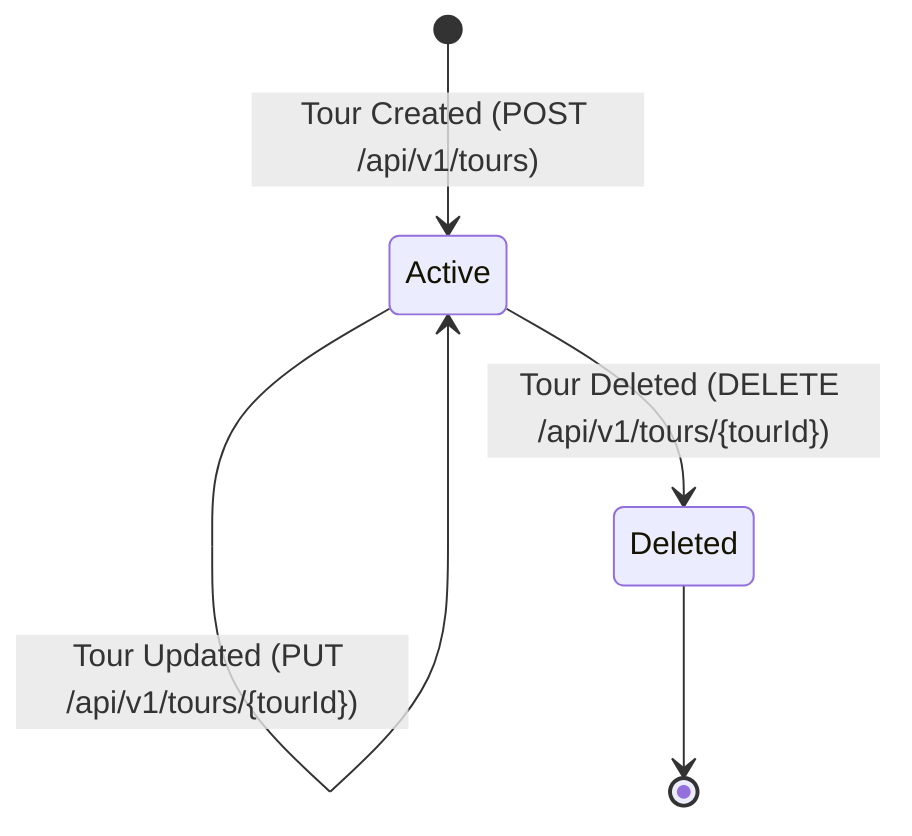

### 5.4 Migration Plan

| Script | Description |
|--------|-------------|
| `V1__init_schema.sql` | Create tables: `port`, `tour`, `port_image`, `tour_image`, `app_user`, `user_role`, `audit_log`; all constraints, indexes, check constraints |
| `V2__seed_roles_and_admin.sql` | Insert default `db_admin` user (password from env var placeholder); insert role mappings |
| `V3__legacy_role_mapping.sql` | Document and insert legacy Domino role → RBAC role mapping reference data |
| `V4__add_tour_version_column.sql` | Add `version` column to `tour` if not already in V1 (idempotent) |

---

## 6. Backend Design

### 6.1 Package Structure

```
com.shoreexcursions.app
├── config
│   ├── SecurityConfig.java
│   ├── JwtConfig.java
│   ├── OpenApiConfig.java
│   ├── AuditConfig.java
│   └── WebMvcConfig.java
├── security
│   ├── JwtTokenProvider.java
│   ├── JwtAuthenticationFilter.java
│   ├── UserDetailsServiceImpl.java
│   └── SecurityConstants.java
├── exception
│   ├── GlobalExceptionHandler.java
│   ├── ResourceNotFoundException.java
│   ├── DuplicateResourceException.java
│   ├── BusinessRuleViolationException.java
│   ├── UnauthorizedException.java
│   └── ErrorResponse.java
├── audit
│   ├── AuditLogEntity.java
│   ├── AuditLogRepository.java
│   ├── AuditService.java
│   └── AuditServiceImpl.java
├── port
│   ├── controller
│   │   └── PortController.java
│   ├── service
│   │   ├── PortService.java
│   │   └── impl
│   │       └── PortServiceImpl.java
│   ├── repository
│   │   ├── PortRepository.java
│   │   └── PortImageRepository.java
│   ├── domain
│   │   ├── Port.java
│   │   └── PortImage.java
│   ├── dto
│   │   ├── PortRequestDto.java
│   │   ├── PortResponseDto.java
│   │   ├── PortSummaryDto.java
│   │   └── PortImageDto.java
│   └── mapper
│       └── PortMapper.java
├── tour
│   ├── controller
│   │   └── TourController.java
│   ├── service
│   │   ├── TourService.java
│   │   └── impl
│   │       └── TourServiceImpl.java
│   ├── repository
│   │   ├── TourRepository.java
│   │   └── TourImageRepository.java
│   ├── domain
│   │   ├── Tour.java
│   │   └── TourImage.java
│   ├── dto
│   │   ├── TourRequestDto.java
│   │   ├── TourResponseDto.java
│   │   ├── TourSummaryDto.java
│   │   └── TourImageDto.java
│   └── mapper
│       └── TourMapper.java
├── user
│   ├── controller
│   │   └── UserController.java
│   ├── service
│   │   ├── UserService.java
│   │   └── impl
│   │       └── UserServiceImpl.java
│   ├── repository
│   │   └── UserRepository.java
│   ├── domain
│   │   ├── AppUser.java
│   │   └── UserRole.java
│   ├── dto
│   │   ├── UserRequestDto.java
│   │   ├── UserResponseDto.java
│   │   ├── RoleAssignmentDto.java
│   │   └── PasswordResetRequestDto.java
│   └── mapper
│       └── UserMapper.java
├── auth
│   ├── controller
│   │   └── AuthController.java
│   ├── service
│   │   ├── AuthService.java
│   │   └── impl
│   │       └── AuthServiceImpl.java
│   └── dto
│       ├── LoginRequestDto.java
│       ├── LoginResponseDto.java
│       └── PasswordResetDto.java
├── image
│   ├── controller
│   │   └── ImageController.java
│   ├── service
│   │   ├── ImageStorageService.java
│   │   └── impl
│   │       └── LocalImageStorageServiceImpl.java
│   └── dto
│       └── ImageUploadResponseDto.java
└── common
    ├── PagedResponse.java
    ├── BaseEntity.java
    └── AuditableEntity.java
```

### 6.2 Class Diagram

#### Module: Port

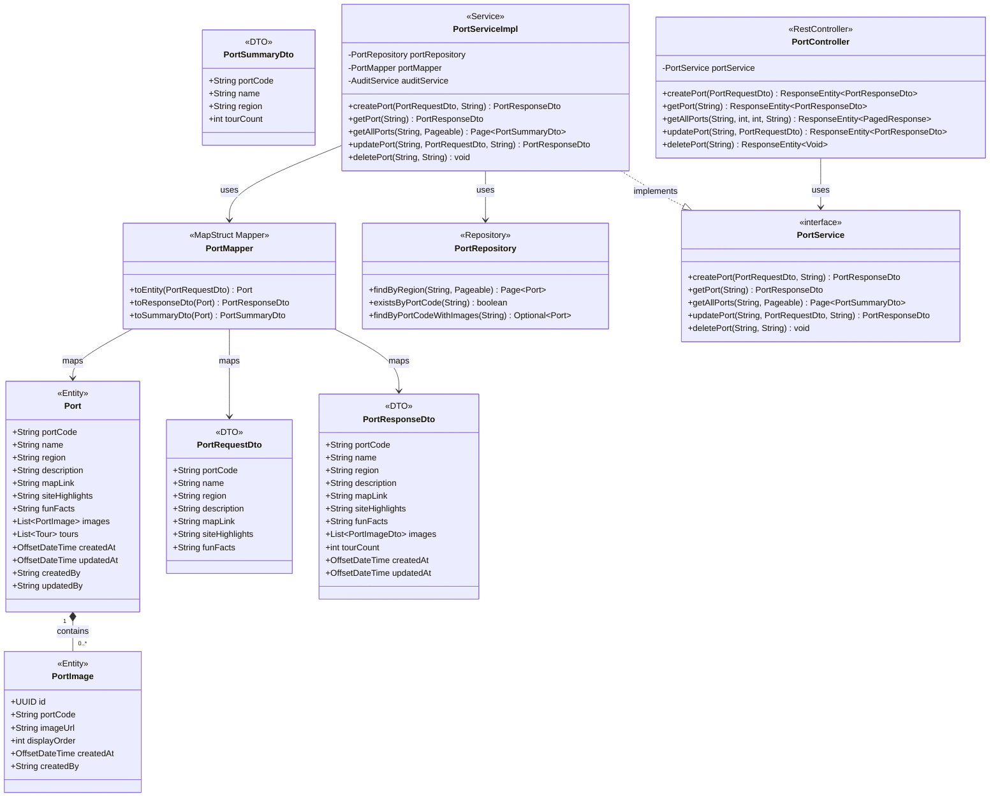

#### Module: Tour

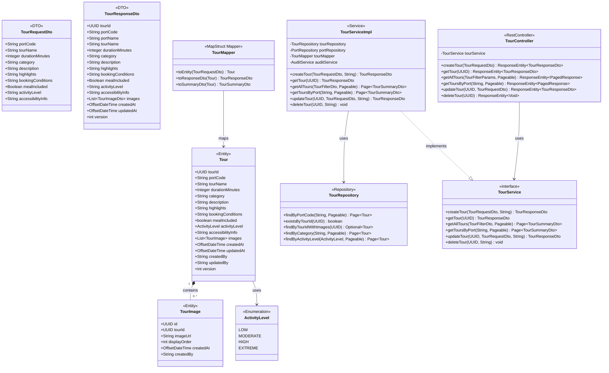

#### Module: Auth & User

```mermaid
classDiagram
    class AppUser {
        <<Entity>>
        +UUID userId
        +String email
        +String username
        +String passwordHash
        +boolean enabled
        +int failedLoginAttempts
        +OffsetDateTime lockedUntil
        +Set~UserRole~ roles
        +OffsetDateTime createdAt
        +OffsetDateTime updatedAt
    }

    class UserRole {
        <<Entity>>
        +UUID userId
        +String role
    }

    class LoginRequestDto {
        <<DTO>>
        +String username
        +String password
    }

    class LoginResponseDto {
        <<DTO>>
        +String accessToken
        +String tokenType
        +long expiresIn
        +String username
        +List~String~ roles
    }

    class AuthService {
        <<interface>>
        +login(LoginRequestDto) LoginResponseDto
        +resetPassword(String, PasswordResetDto) void
        +requestPasswordReset(String) void
    }

    class AuthServiceImpl {
        <<Service>>
        -UserRepository userRepository
        -JwtTokenProvider jwtTokenProvider
        -PasswordEncoder passwordEncoder
        -AuditService auditService
        +login(LoginRequestDto) LoginResponseDto
        +resetPassword(String, PasswordResetDto) void
        +requestPasswordReset(String) void
    }

    class AuthController {
        <<RestController>>
        -AuthService authService
        +login(LoginRequestDto) ResponseEntity~LoginResponseDto~
        +requestPasswordReset(String) ResponseEntity~Void~
        +resetPassword(String, PasswordResetDto) ResponseEntity~Void~
    }

    class UserService {
        <<interface>>
        +createUser(UserRequestDto, String) UserResponseDto
        +getUser(UUID) UserResponseDto
        +getAllUsers(Pageable) Page~UserResponseDto~
        +updateUser(UUID, UserRequestDto, String) UserResponseDto
        +assignRoles(UUID, RoleAssignmentDto, String) UserResponseDto
        +deleteUser(UUID, String) void
    }

    class UserServiceImpl {
        <<Service>>
        -UserRepository userRepository
        -UserMapper userMapper
        -AuditService auditService
        -PasswordEncoder passwordEncoder
        +createUser(UserRequestDto, String) UserResponseDto
        +getUser(UUID) UserResponseDto
        +getAllUsers(Pageable) Page~UserResponseDto~
        +updateUser(UUID, UserRequestDto, String) UserResponseDto
        +assignRoles(UUID, RoleAssignmentDto, String) UserResponseDto
        +deleteUser(UUID, String) void
    }

    class JwtTokenProvider {
        +generateToken(UserDetails) String
        +validateToken(String) boolean
        +getUsernameFromToken(String) String
        +getExpirationFromToken(String) Date
    }

    class JwtAuthenticationFilter {
        +doFilterInternal(HttpServletRequest, HttpServletResponse, FilterChain) void
    }

    AppUser "1" *-- "1..*" UserRole : has
    AuthServiceImpl ..|> AuthService : implements
    AuthController --> AuthService : uses
    UserServiceImpl ..|> UserService : implements
    AuthServiceImpl --> JwtTokenProvider : uses
    JwtAuthenticationFilter --> JwtTokenProvider : uses
```

### 6.3 Class Specifications

#### `PortServiceImpl`
- **Pattern:** Service Layer
- **Responsibility:** Enforces all port business rules; orchestrates repository and audit calls.
- **Transaction Boundaries:** All write methods annotated `@Transactional`; read methods `@Transactional(readOnly = true)`.

| Method | Parameters | Return Type | Exceptions | Business Rules |
|--------|-----------|-------------|------------|----------------|
| `createPort` | `PortRequestDto dto, String currentUser` | `PortResponseDto` | `DuplicateResourceException` | Port code must be unique (US-024); required fields validated |
| `getPort` | `String portCode` | `PortResponseDto` | `ResourceNotFoundException` | Returns 404 if not found |
| `getAllPorts` | `String region, Pageable pageable` | `Page<PortSummaryDto>` | — | Filters by region if provided; paginated |
| `updatePort` | `String portCode, PortRequestDto dto, String currentUser` | `PortResponseDto` | `ResourceNotFoundException` | Port code cannot be changed; audit trail updated |
| `deletePort` | `String portCode, String currentUser` | `void` | `ResourceNotFoundException`, `BusinessRuleViolationException` | Cannot delete if active tours exist (US-004); logs deletion to audit_log |

#### `TourServiceImpl`
- **Pattern:** Service Layer
- **Responsibility:** Enforces tour business rules; validates port FK existence.
- **Transaction Boundaries:** All write methods `@Transactional`; reads `@Transactional(readOnly = true)`.

| Method | Parameters | Return Type | Exceptions | Business Rules |
|--------|-----------|-------------|------------|----------------|
| `createTour` | `TourRequestDto dto, String currentUser` | `TourResponseDto` | `ResourceNotFoundException`, `DuplicateResourceException` | Port code must exist (US-026); tourId is UUID auto-generated |
| `getTour` | `UUID tourId` | `TourResponseDto` | `ResourceNotFoundException` | — |
| `getAllTours` | `TourFilterDto filter, Pageable pageable` | `Page<TourSummaryDto>` | — | Filter by category, activityLevel, portCode |
| `getToursByPort` | `String portCode, Pageable pageable` | `Page<TourSummaryDto>` | `ResourceNotFoundException` | Port must exist |
| `updateTour` | `UUID tourId, TourRequestDto dto, String currentUser` | `TourResponseDto` | `ResourceNotFoundException`, `OptimisticLockingFailureException` | Port code must exist if changed; version checked for optimistic locking |
| `deleteTour` | `UUID tourId, String currentUser` | `void` | `ResourceNotFoundException` | Logs deletion to audit_log |

#### `AuthServiceImpl`
- **Pattern:** Service Layer
- **Responsibility:** Authenticates users, issues JWT tokens, handles password reset.

| Method | Parameters | Return Type | Exceptions | Business Rules |
|--------|-----------|-------------|------------|----------------|
| `login` | `LoginRequestDto dto` | `LoginResponseDto` | `UnauthorizedException` | Validates credentials; increments `failedLoginAttempts`; locks after 5 failures (US-037); resets counter on success |
| `requestPasswordReset` | `String email` | `void` | — | Generates time-limited token (24h); stores hash; stub for email send (US-046) |
| `resetPassword` | `String token, PasswordResetDto dto` | `void` | `UnauthorizedException` | Validates token not expired/used; enforces password policy; invalidates token |

#### `AuditServiceImpl`
- **Pattern:** Service Layer
- **Responsibility:** Persists audit log entries for all mutable operations.

| Method | Parameters | Return Type |
|--------|-----------|-------------|
| `log` | `String entityType, String entityId, AuditAction action, String performedBy, Object oldValue, Object newValue` | `void` |

#### `JwtTokenProvider`
- **Pattern:** Utility/Helper
- **Responsibility:** Generates, validates, and parses JWT tokens.
- Uses `io.jsonwebtoken` (JJWT library — added because US-037 requires stateless JWT auth).

#### `GlobalExceptionHandler`
- **Pattern:** `@RestControllerAdvice`
- **Responsibility:** Maps all exceptions to standardized `ErrorResponse` JSON.

### 6.4 REST API Specification

#### Authentication APIs

| API ID | Method | Path | Description | Roles | Request Body | Success | Error Codes | Related US |
|--------|--------|------|-------------|-------|-------------|---------|-------------|------------|
| API-001 | POST | `/api/v1/auth/login` | Authenticate user and return JWT | Public | `LoginRequestDto` | 200 `LoginResponseDto` | 400, 401 | US-037 |
| API-002 | POST | `/api/v1/auth/password-reset/request` | Request password reset link | Public | `{ "email": string }` | 202 | 400 | US-046 |
| API-003 | POST | `/api/v1/auth/password-reset/confirm` | Confirm password reset with token | Public | `PasswordResetDto` | 200 | 400, 410 | US-046 |

#### Port APIs

| API ID | Method | Path | Description | Roles | Request Body / Params | Success | Error Codes | Related US |
|--------|--------|------|-------------|-------|-----------------------|---------|-------------|------------|
| API-004 | GET | `/api/v1/ports` | List all ports (paginated) | ALL_AUTHENTICATED | Query: `region`, `page` (0), `size` (20), `sort` (name,asc) | 200 `PagedResponse<PortSummaryDto>` | 401 | US-009, US-011 |
| API-005 | GET | `/api/v1/ports/{portCode}` | Get port by code | ALL_AUTHENTICATED | Path: `portCode` | 200 `PortResponseDto` | 401, 404 | US-002, US-012 |
| API-006 | POST | `/api/v1/ports` | Create new port | DB_ADMIN, EDITOR | `PortRequestDto` | 201 `PortResponseDto` | 400, 401, 403, 409 | US-001, US-013 |
| API-007 | PUT | `/api/v1/ports/{portCode}` | Update port | DB_ADMIN, EDITOR | Path: `portCode`; Body: `PortRequestDto` | 200 `PortResponseDto` | 400, 401, 403, 404 | US-003, US-014 |
| API-008 | DELETE | `/api/v1/ports/{portCode}` | Delete port | DB_ADMIN | Path: `portCode` | 204 | 401, 403, 404, 409 | US-004 |

#### Tour APIs

| API ID | Method | Path | Description | Roles | Request Body / Params | Success | Error Codes | Related US |
|--------|--------|------|-------------|-------|-----------------------|---------|-------------|------------|
| API-009 | GET | `/api/v1/tours` | List all tours (paginated, filterable) | ALL_AUTHENTICATED | Query: `portCode`, `category`, `activityLevel`, `page`, `size`, `sort` | 200 `PagedResponse<TourSummaryDto>` | 401 | US-010, US-015 |
| API-010 | GET | `/api/v1/tours/{tourId}` | Get tour by ID | ALL_AUTHENTICATED | Path: `tourId` (UUID) | 200 `TourResponseDto` | 401, 404 | US-006, US-017 |
| API-011 | POST | `/api/v1/tours` | Create new tour | DB_ADMIN, EDITOR | `TourRequestDto` | 201 `TourResponseDto` | 400, 401, 403, 409 | US-005, US-018 |
| API-012 | PUT | `/api/v1/tours/{tourId}` | Update tour | DB_ADMIN, EDITOR | Path: `tourId`; Body: `TourRequestDto` | 200 `TourResponseDto` | 400, 401, 403, 404, 409 | US-007, US-019 |
| API-013 | DELETE | `/api/v1/tours/{tourId}` | Delete tour | DB_ADMIN | Path: `tourId` | 204 | 401, 403, 404 | US-008 |
| API-014 | GET | `/api/v1/ports/{portCode}/tours` | Get tours by port | ALL_AUTHENTICATED | Path: `portCode`; Query: `page`, `size`, `sort` | 200 `PagedResponse<TourSummaryDto>` | 401, 404 | US-010, US-016 |

#### Image APIs

| API ID | Method | Path | Description | Roles | Request | Success | Error Codes | Related US |
|--------|--------|------|-------------|-------|---------|---------|-------------|------------|
| API-015 | POST | `/api/v1/ports/{portCode}/images` | Upload image for port | DB_ADMIN, EDITOR | Multipart: `file` (JPEG/PNG/GIF, max 5MB) | 201 `ImageUploadResponseDto` | 400, 401, 403, 404 | US-031 |
| API-016 | DELETE | `/api/v1/ports/{portCode}/images/{imageId}` | Delete port image | DB_ADMIN, EDITOR | Path params | 204 | 401, 403, 404 | US-031 |
| API-017 | POST | `/api/v1/tours/{tourId}/images` | Upload image for tour | DB_ADMIN, EDITOR | Multipart: `file` (JPEG/PNG/GIF, max 5MB) | 201 `ImageUploadResponseDto` | 400, 401, 403, 404 | US-031 |
| API-018 | DELETE | `/api/v1/tours/{tourId}/images/{imageId}` | Delete tour image | DB_ADMIN, EDITOR | Path params | 204 | 401, 403, 404 | US-031 |

#### User Management APIs

| API ID | Method | Path | Description | Roles | Request Body | Success | Error Codes | Related US |
|--------|--------|------|-------------|-------|-------------|---------|-------------|------------|
| API-019 | GET | `/api/v1/users` | List all users | DB_ADMIN | Query: `page`, `size` | 200 `PagedResponse<UserResponseDto>` | 401, 403 | US-038, US-039 |
| API-020 | GET | `/api/v1/users/{userId}` | Get user by ID | DB_ADMIN | Path: `userId` | 200 `UserResponseDto` | 401, 403, 404 | US-038 |
| API-021 | POST | `/api/v1/users` | Create user | DB_ADMIN | `UserRequestDto` | 201 `UserResponseDto` | 400, 401, 403, 409 | US-038 |
| API-022 | PUT | `/api/v1/users/{userId}` | Update user | DB_ADMIN | `UserRequestDto` | 200 `UserResponseDto` | 400, 401, 403, 404 | US-038 |
| API-023 | PUT | `/api/v1/users/{userId}/roles` | Assign roles to user | DB_ADMIN | `RoleAssignmentDto` | 200 `UserResponseDto` | 400, 401, 403, 404 | US-038, US-048 |
| API-024 | DELETE | `/api/v1/users/{userId}` | Delete user | DB_ADMIN | Path: `userId` | 204 | 401, 403, 404 | US-039 |

#### Audit & Health APIs

| API ID | Method | Path | Description | Roles | Success | Error Codes | Related US |
|--------|--------|------|-------------|-------|---------|-------------|------------|
| API-025 | GET | `/api/v1/audit-logs` | Query audit logs | DB_ADMIN | 200 `PagedResponse<AuditLogDto>` | 401, 403 | US-045 |
| API-026 | GET | `/actuator/health` | Application health check | Public | 200 `{ status: UP }` | — | US-055 |
| API-027 | GET | `/actuator/metrics` | Application metrics | DB_ADMIN | 200 | 401, 403 | US-055 |

**Pagination Contract (all list endpoints):**
- Query params: `page` (0-based, default 0), `size` (default 20, max 100), `sort` (field,direction e.g. `name,asc`)
- Response: `PagedResponse<T>` with `content[]`, `page`, `size`, `totalElements`, `totalPages`, `last`

### 6.5 Validation and Business Rules

| Field / Rule | Validation | Enforcement | Related US |
|---|---|---|---|
| `port.portCode` | `@NotBlank`, `@Size(max=10)`, `@Pattern([A-Z0-9]+)` | Bean Validation + DB UK | US-001, US-024, US-027 |
| `port.name` | `@NotBlank`, `@Size(max=100)` | Bean Validation | US-001, US-027 |
| `port.region` | `@NotBlank`, `@Size(max=100)` | Bean Validation | US-001, US-027 |
| `tour.portCode` | `@NotBlank`; FK existence check in service | Bean Validation + Service | US-005, US-026, US-027 |
| `tour.tourName` | `@NotBlank`, `@Size(max=200)` | Bean Validation | US-005, US-027 |
| `tour.durationMinutes` | `@Positive` (if provided) | Bean Validation | US-005 |
| `tour.activityLevel` | `@Pattern` or enum validation | Bean Validation | US-005 |
| Port uniqueness | Service checks `portRepository.existsByPortCode()` before insert | Service layer | US-024 |
| Tour FK to Port | Service checks `portRepository.existsByPortCode()` before insert/update | Service layer | US-026 |
| Delete port with tours | Service checks `tourRepository.countByPortCode() > 0` → throws `BusinessRuleViolationException` | Service layer | US-004 |
| Account lockout | After 5 failed logins, set `lockedUntil = NOW() + 30 min` (design default) | AuthServiceImpl | US-037 |
| Password complexity | `@Pattern` on `PasswordResetDto.newPassword` | Bean Validation | US-037, US-046 |
| Image file type | `@ContentType({"image/jpeg","image/png","image/gif"})` via custom validator | Bean Validation | US-031 |
| Image file size | Max 5 MB (design default); enforced via `spring.servlet.multipart.max-file-size` | Spring config | US-031 |
| Max images per entity | Service checks count ≤ 10 before adding | Service layer | US-031, A-02 (Q-02) |
| JWT expiry | 8 hours (design default) | JwtTokenProvider | US-037 |
| Password reset token expiry | 24 hours (design default) | AuthServiceImpl | US-046 |

### 6.6 Error Handling

#### Standard Error Response Schema
```json
{
  "timestamp": "2025-07-10T12:00:00Z",
  "status": 400,
  "errorCode": "VALIDATION_ERROR",
  "message": "Request validation failed",
  "path": "/api/v1/ports",
  "traceId": "abc123xyz",
  "fieldErrors": [
    { "field": "portCode", "message": "Port code must be alphanumeric uppercase, max 10 chars" }
  ]
}
```

#### Error Code Catalogue

| Error Code | HTTP Status | Description |
|---|---|---|
| `VALIDATION_ERROR` | 400 | Bean validation or business rule validation failed |
| `DUPLICATE_RESOURCE` | 409 | Unique constraint violation (port code, tour ID, email) |
| `RESOURCE_NOT_FOUND` | 404 | Entity not found by given identifier |
| `BUSINESS_RULE_VIOLATION` | 409 | Business rule prevents operation (e.g., delete port with tours) |
| `UNAUTHORIZED` | 401 | Missing or invalid JWT token |
| `FORBIDDEN` | 403 | Authenticated but insufficient role |
| `OPTIMISTIC_LOCK_CONFLICT` | 409 | Concurrent update conflict on tour |
| `ACCOUNT_LOCKED` | 401 | User account locked due to failed attempts |
| `TOKEN_EXPIRED` | 410 | Password reset token expired or already used |
| `INTERNAL_SERVER_ERROR` | 500 | Unexpected server error |
| `IMAGE_LIMIT_EXCEEDED` | 400 | Maximum image count reached for entity |
| `INVALID_FILE_TYPE` | 400 | Uploaded file is not an accepted image type |

#### `@RestControllerAdvice` Mapping

| Exception Class | HTTP Status | Error Code |
|---|---|---|
| `MethodArgumentNotValidException` | 400 | `VALIDATION_ERROR` |
| `ConstraintViolationException` | 400 | `VALIDATION_ERROR` |
| `ResourceNotFoundException` | 404 | `RESOURCE_NOT_FOUND` |
| `DuplicateResourceException` | 409 | `DUPLICATE_RESOURCE` |
| `BusinessRuleViolationException` | 409 | `BUSINESS_RULE_VIOLATION` |
| `UnauthorizedException` | 401 | `UNAUTHORIZED` |
| `AccessDeniedException` | 403 | `FORBIDDEN` |
| `OptimisticLockingFailureException` | 409 | `OPTIMISTIC_LOCK_CONFLICT` |
| `MaxUploadSizeExceededException` | 400 | `VALIDATION_ERROR` |
| `Exception` (catch-all) | 500 | `INTERNAL_SERVER_ERROR` |

---

## 7. Frontend Design

### 7.1 Project Structure

```
src/
├── app/
│   ├── App.tsx
│   ├── routes.tsx
│   └── store.ts
├── features/
│   ├── auth/
│   │   ├── pages/
│   │   │   ├── LoginPage.tsx
│   │   │   └── PasswordResetPage.tsx
│   │   ├── components/
│   │   │   ├── LoginForm.tsx
│   │   │   └── PasswordResetForm.tsx
│   │   ├── hooks/
│   │   │   └── useAuth.ts
│   │   └── authSlice.ts
│   ├── ports/
│   │   ├── pages/
│   │   │   ├── PortListPage.tsx
│   │   │   ├── PortDetailPage.tsx
│   │   │   ├── PortCreatePage.tsx
│   │   │   └── PortEditPage.tsx
│   │   ├── components/
│   │   │   ├── PortTable.tsx
│   │   │   ├── PortForm.tsx
│   │   │   ├── PortCard.tsx
│   │   │   └── PortImageManager.tsx
│   │   └── hooks/
│   │       └── usePorts.ts
│   ├── tours/
│   │   ├── pages/
│   │   │   ├── TourListPage.tsx
│   │   │   ├── TourDetailPage.tsx
│   │   │   ├── TourCreatePage.tsx
│   │   │   └── TourEditPage.tsx
│   │   ├── components/
│   │   │   ├── TourTable.tsx
│   │   │   ├── TourForm.tsx
│   │   │   ├── TourCard.tsx
│   │   │   └── TourImageManager.tsx
│   │   └── hooks/
│   │       └── useTours.ts
│   ├── users/
│   │   ├── pages/
│   │   │   ├── UserListPage.tsx
│   │   │   ├── UserCreatePage.tsx
│   │   │   └── UserEditPage.tsx
│   │   ├── components/
│   │   │   ├── UserTable.tsx
│   │   │   ├── UserForm.tsx
│   │   │   └── RoleAssignmentForm.tsx
│   │   └── hooks/
│   │       └── useUsers.ts
│   ├── audit/
│   │   ├── pages/
│   │   │   └── AuditLogPage.tsx
│   │   └── components/
│   │       └── AuditLogTable.tsx
│   └── dashboard/
│       ├── pages/
│       │   └── DashboardPage.tsx
│       └── components/
│           ├── StatCard.tsx
│           └── RecentActivityList.tsx
├── components/
│   ├── common/
│   │   ├── TextInput.tsx
│   │   ├── TextArea.tsx
│   │   ├── SelectInput.tsx
│   │   ├── ImageUpload.tsx
│   │   ├── DataTable.tsx
│   │   ├── ActionButton.tsx
│   │   ├── ConfirmDialog.tsx
│   │   ├── Pagination.tsx
│   │   ├── ErrorSummary.tsx
│   │   ├── LoadingSpinner.tsx
│   │   └── EmptyState.tsx
│   └── layout/
│       ├── AppLayout.tsx
│       ├── Navbar.tsx
│       ├── Sidebar.tsx
│       └── ProtectedRoute.tsx
├── services/
│   └── api/
│       ├── apiClient.ts
│       ├── authApi.ts
│       ├── portApi.ts
│       ├── tourApi.ts
│       ├── userApi.ts
│       ├── imageApi.ts
│       └── auditApi.ts
├── types/
│   ├── auth.types.ts
│   ├── port.types.ts
│   ├── tour.types.ts
│   ├── user.types.ts
│   ├── audit.types.ts
│   └── common.types.ts
├── hooks/
│   ├── useDebounce.ts
│   ├── usePagination.ts
│   └── usePermissions.ts
├── utils/
│   ├── validators.ts
│   ├── formatters.ts
│   └── constants.ts
└── store/
    ├── index.ts
    └── authSlice.ts
```

### 7.2 Page and Route Map

| Route | Page Component | Access Role | Related US |
|-------|---------------|-------------|------------|
| `/login` | `LoginPage` | Public | US-037 |
| `/password-reset` | `PasswordResetPage` | Public | US-046 |
| `/dashboard` | `DashboardPage` | ALL_AUTHENTICATED | US-033 |
| `/ports` | `PortListPage` | ALL_AUTHENTICATED | US-009, US-011 |
| `/ports/new` | `PortCreatePage` | DB_ADMIN, EDITOR | US-001, US-013 |
| `/ports/:portCode` | `PortDetailPage` | ALL_AUTHENTICATED | US-002, US-012 |
| `/ports/:portCode/edit` | `PortEditPage` | DB_ADMIN, EDITOR | US-003, US-014 |
| `/tours` | `TourListPage` | ALL_AUTHENTICATED | US-010, US-015 |
| `/tours/new` | `TourCreatePage` | DB_ADMIN, EDITOR | US-005, US-018 |
| `/tours/:tourId` | `TourDetailPage` | ALL_AUTHENTICATED | US-006, US-017 |
| `/tours/:tourId/edit` | `TourEditPage` | DB_ADMIN, EDITOR | US-007, US-019 |
| `/ports/:portCode/tours` | `TourListPage` (filtered) | ALL_AUTHENTICATED | US-010, US-016 |
| `/users` | `UserListPage` | DB_ADMIN | US-038, US-039 |
| `/users/new` | `UserCreatePage` | DB_ADMIN | US-038 |
| `/users/:userId/edit` | `UserEditPage` | DB_ADMIN | US-038, US-048 |
| `/audit-logs` | `AuditLogPage` | DB_ADMIN | US-045 |
| `*` | Redirect to `/dashboard` | — | — |

### 7.3 Component Design

#### Port List Page Component Hierarchy

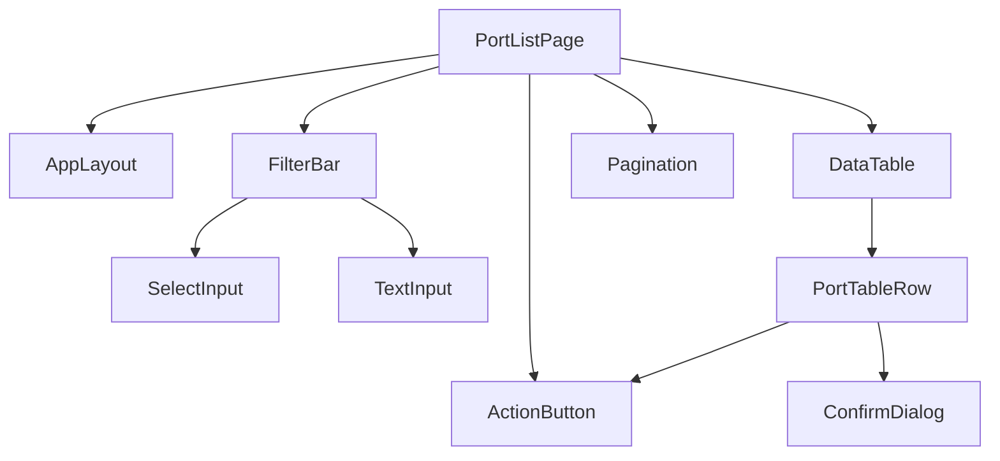

#### Port Form Component Hierarchy

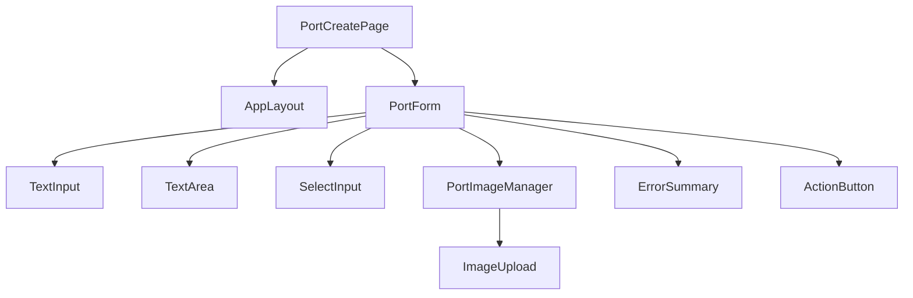

#### Key Component Specifications

**`PortForm`**
- **Props:** `initialValues?: PortFormValues`, `onSubmit: (data: PortFormValues) => void`, `isLoading: boolean`, `mode: 'create' | 'edit'`
- **Local State:** React Hook Form state via `useForm<PortFormValues>()` with Zod schema resolver
- **Responsibilities:** Renders all port fields; validates with Zod schema mirroring backend rules; displays inline errors; disables submit during loading

**`DataTable`**
- **Props:** `columns: ColumnDef[]`, `data: T[]`, `isLoading: boolean`, `onSort: (field, dir) => void`, `onRowClick?: (row: T) => void`
- **Local State:** Sort state
- **Responsibilities:** Renders sortable, filterable table; shows `LoadingSpinner` or `EmptyState` as appropriate

**`ImageUpload`**
- **Props:** `entityType: 'port' | 'tour'`, `entityId: string`, `images: ImageDto[]`, `onUpload: (file: File) => void`, `onDelete: (imageId: string) => void`, `maxImages: number`
- **Local State:** Preview URLs, upload progress
- **Responsibilities:** Drag-and-drop + file browser; validates type and size client-side; shows previews; enforces max count

**`ProtectedRoute`**
- **Props:** `allowedRoles: string[]`, `children: ReactNode`
- **Responsibilities:** Reads auth state from Redux store; redirects to `/login` if unauthenticated; shows 403 page if insufficient role

**`ConfirmDialog`**
- **Props:** `open: boolean`, `title: string`, `message: string`, `onConfirm: () => void`, `onCancel: () => void`, `variant: 'danger' | 'warning'`
- **Responsibilities:** Modal confirmation for destructive actions (delete port, delete tour, delete user)

### 7.4 State Management and API Integration

**Server State:** Managed via React Query (`@tanstack/react-query`) — added because multiple pages need cache invalidation, loading states, and background refetching for list/detail views.

**Client State:** Redux Toolkit (`authSlice`) — stores JWT token, user info, and roles. Persisted to `localStorage`.

**API Client (`apiClient.ts`):**
```typescript
// Axios instance with base URL and JWT interceptor
const apiClient = axios.create({
  baseURL: process.env.REACT_APP_API_BASE_URL,
});
apiClient.interceptors.request.use((config) => {
  const token = store.getState().auth.token;
  if (token) config.headers.Authorization = `Bearer ${token}`;
  return config;
});
apiClient.interceptors.response.use(
  (res) => res,
  (err) => {
    if (err.response?.status === 401) store.dispatch(logout());
    return Promise.reject(err);
  }
);
```

**TypeScript Types (examples):**
```typescript
// types/port.types.ts
export interface PortSummaryDto {
  portCode: string;
  name: string;
  region: string;
  tourCount: number;
}

export interface PortResponseDto extends PortSummaryDto {
  description?: string;
  mapLink?: string;
  siteHighlights?: string;
  funFacts?: string;
  images: PortImageDto[];
  createdAt: string;
  updatedAt: string;
}

export interface PagedResponse<T> {
  content: T[];
  page: number;
  size: number;
  totalElements: number;
  totalPages: number;
  last: boolean;
}
```

**Form Validation (Zod schema mirroring backend):**
```typescript
// Port form schema
const portSchema = z.object({
  portCode: z.string().min(1).max(10).regex(/^[A-Z0-9]+$/, 'Uppercase alphanumeric only'),
  name: z.string().min(1).max(100),
  region: z.string().min(1).max(100),
  description: z.string().optional(),
  mapLink: z.string().url().optional().or(z.literal('')),
  siteHighlights: z.string().optional(),
  funFacts: z.string().optional(),
});
```

**Loading/Error/Empty State Handling:**
- `isLoading`: Show `<LoadingSpinner />` overlay
- `isError`: Show `<ErrorSummary errors={[error.message]} />`
- Empty list: Show `<EmptyState message="No records found" />`
- Form submit error: Map API `fieldErrors[]` to React Hook Form `setError()`

### 7.5 UX Rules

| Rule | Description | Related US |
|------|-------------|------------|
| Required field marking | All required fields marked with `*` and `aria-required="true"` | US-027, US-035 |
| Inline validation | Errors shown below field on blur; red border on invalid field | US-035 |
| Error summary | On submit failure, `<ErrorSummary>` at top of form lists all errors with field links | US-035 |
| Confirmation dialogs | Delete port, delete tour, delete user, delete image all require `<ConfirmDialog>` | US-004, US-008, US-034 |
| Disabled submit | Submit button disabled and shows spinner during API call | US-034 |
| Destructive button style | Delete buttons use `variant="danger"` (red) | US-034 |
| Responsive layout | CSS Grid/Flexbox; breakpoints: mobile 375px, tablet 768px, desktop 1280px | US-036 |
| Mobile navigation | Hamburger menu collapses sidebar on mobile | US-036 |
| Touch targets | Minimum 44×44px for all interactive elements | US-036 |
| WCAG 2.1 AA | Color contrast ≥ 4.5:1; all interactive elements keyboard-navigable; `aria-*` labels on icons | US-028–US-036 |
| Role-based UI hiding | Edit/Delete buttons hidden (not just disabled) for VIEWER and USER roles | US-042 |
| Dashboard auto-refresh | Dashboard stats refresh every 60 seconds (design default) | US-033 |

---

## 8. Sequence Diagrams

### Flow 1: User Login (US-037, US-043)

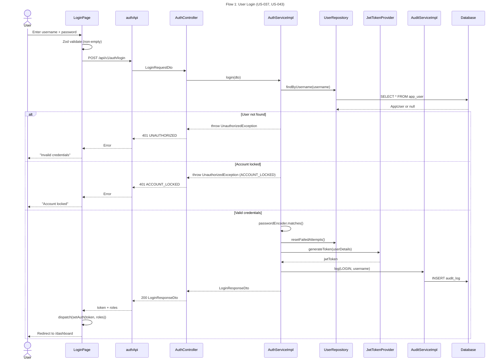

### Flow 2: Create Port (US-001, US-013, US-024, US-027)

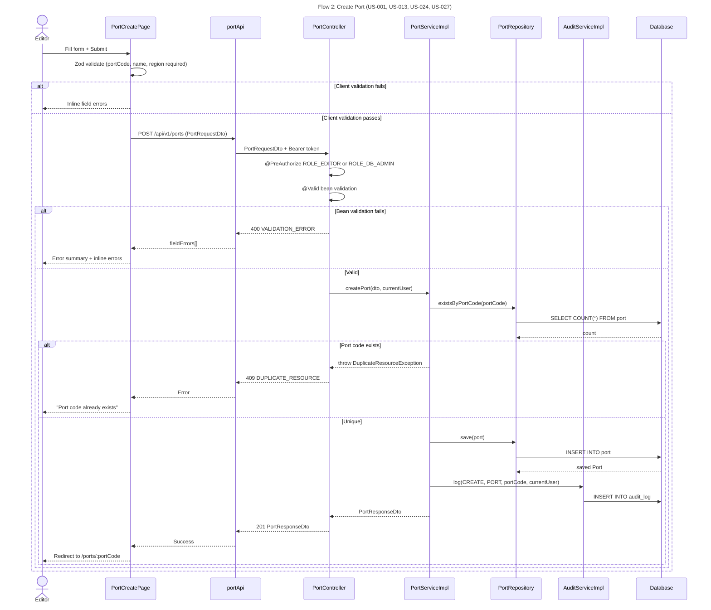

### Flow 3: Update Tour (US-007, US-019, US-026)

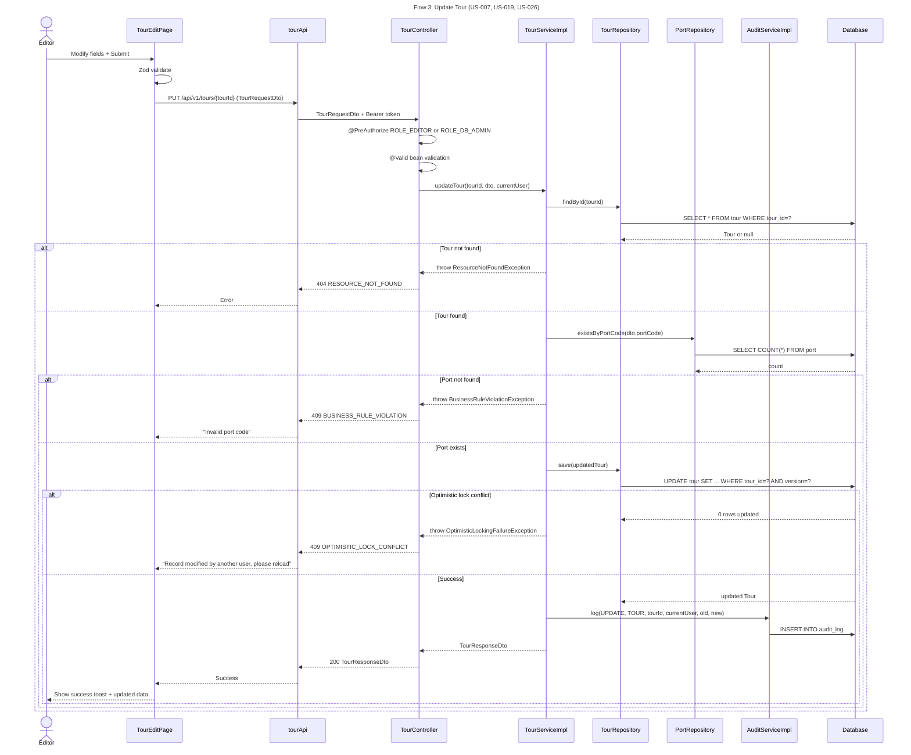

### Flow 4: Delete Port (US-004, US-045)

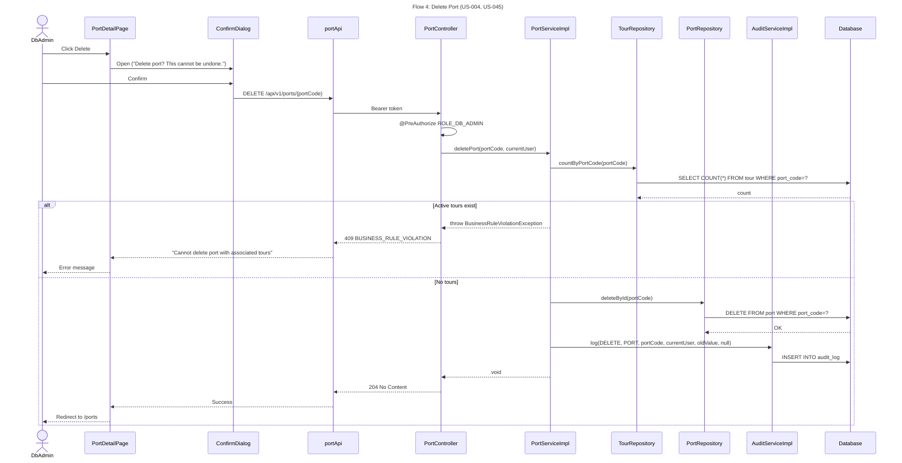

### Flow 5: List Ports with Filtering and Pagination (US-009, US-011)

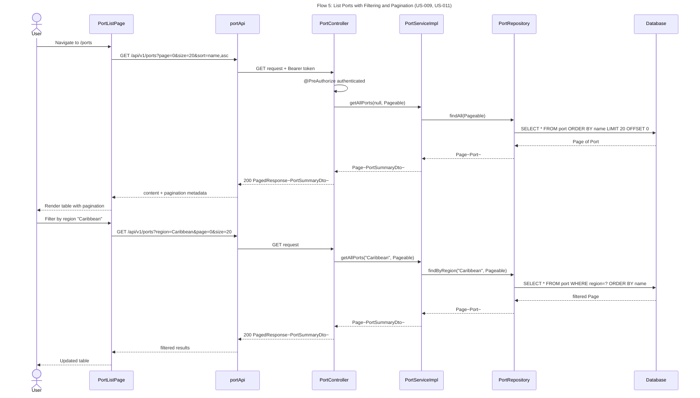

### Flow 6: Upload Image (US-031)

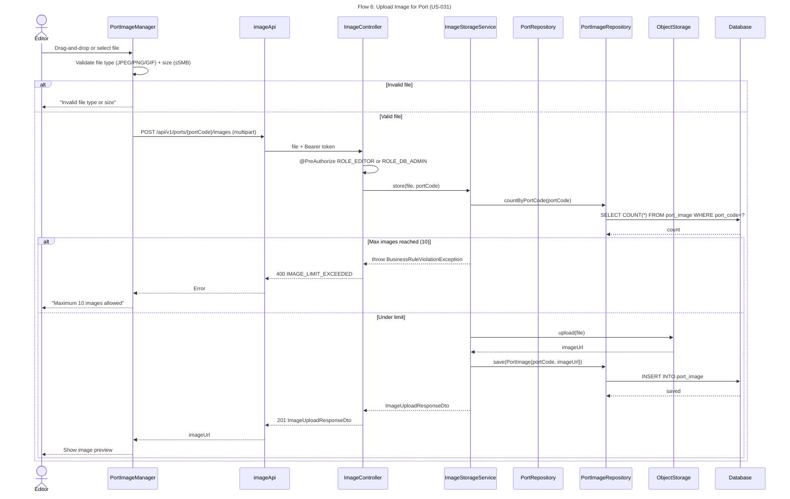

### Flow 7: Password Reset (US-046)

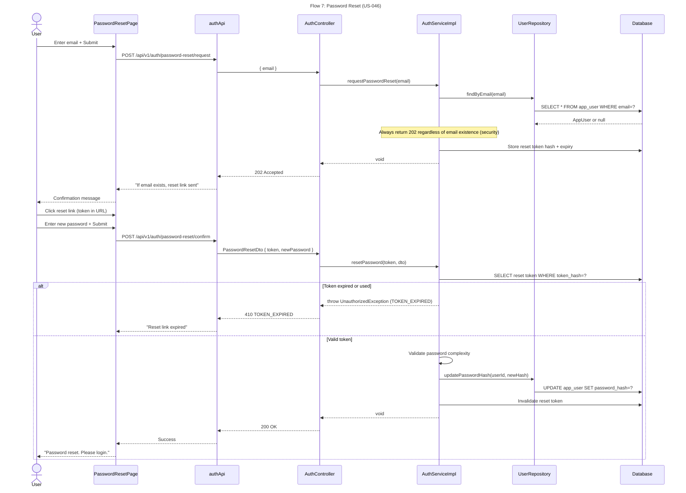

### Flow 8: Role Assignment (US-038, US-048)

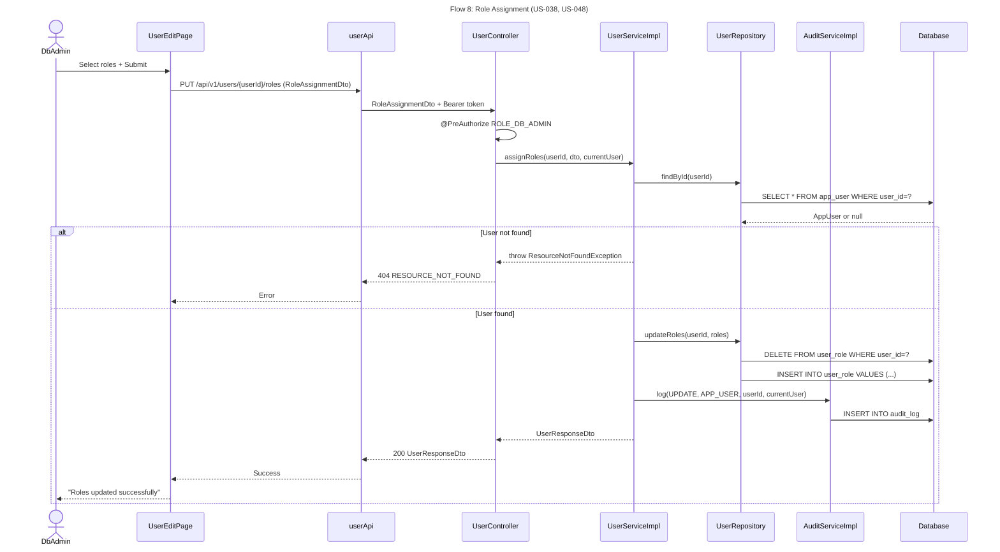

---

## 9. Security Design

### Authentication
- **Mechanism:** JWT Bearer tokens (stateless). Library: `io.jsonwebtoken:jjwt-api` (added for US-037).
- **Token lifetime:** 8 hours (design default, configurable via `app.jwt.expiration-ms`).
- **Storage:** `localStorage` on client (acceptable for internal enterprise app; see OWASP note below).
- **Filter:** `JwtAuthenticationFilter` extends `OncePerRequestFilter`; validates token on every request.

### Authorization — Role-Permission Matrix

| Endpoint / Action | ROLE_VIEWER | ROLE_USER | ROLE_EDITOR | ROLE_DB_ADMIN |
|---|---|---|---|---|
| GET /api/v1/ports | ✅ | ✅ | ✅ | ✅ |
| GET /api/v1/ports/{code} | ✅ | ✅ | ✅ | ✅ |
| POST /api/v1/ports | ❌ | ❌ | ✅ | ✅ |
| PUT /api/v1/ports/{code} | ❌ | ❌ | ✅ | ✅ |
| DELETE /api/v1/ports/{code} | ❌ | ❌ | ❌ | ✅ |
| GET /api/v1/tours | ✅ | ✅ | ✅ | ✅ |
| GET /api/v1/tours/{id} | ✅ | ✅ | ✅ | ✅ |
| POST /api/v1/tours | ❌ | ❌ | ✅ | ✅ |
| PUT /api/v1/tours/{id} | ❌ | ❌ | ✅ | ✅ |
| DELETE /api/v1/tours/{id} | ❌ | ❌ | ❌ | ✅ |
| POST /api/v1/*/images | ❌ | ❌ | ✅ | ✅ |
| DELETE /api/v1/*/images/{id} | ❌ | ❌ | ✅ | ✅ |
| GET /api/v1/users | ❌ | ❌ | ❌ | ✅ |
| POST/PUT/DELETE /api/v1/users | ❌ | ❌ | ❌ | ✅ |
| GET /api/v1/audit-logs | ❌ | ❌ | ❌ | ✅ |
| GET /actuator/health | ✅ (public) | ✅ | ✅ | ✅ |
| GET /actuator/metrics | ❌ | ❌ | ❌ | ✅ |

### Password and Secret Handling
- Passwords hashed with **BCrypt** (strength 12, design default).
- JWT secret stored in environment variable `APP_JWT_SECRET` (min 256-bit, never in code).
- Password reset tokens: SHA-256 hash stored in DB; plaintext token sent in URL only.
- No passwords or secrets logged.

### Input Sanitization
- Bean Validation on all DTOs (server-side).
- Zod validation on all forms (client-side).
- JPA parameterized queries prevent SQL injection.
- `TEXT` fields stored as-is; HTML rendering uses React's default XSS protection (no `dangerouslySetInnerHTML`).

### CORS
- Configured in `WebMvcConfig`: allowed origins from `ALLOWED_ORIGINS` env var; allowed methods: GET, POST, PUT, DELETE, OPTIONS; allowed headers: Authorization, Content-Type; max age: 3600s.

### CSRF
- **Decision:** CSRF protection disabled for stateless JWT API (standard practice). No session cookies used.

### Rate Limiting
- Login endpoint (`/api/v1/auth/login`): application-level rate limit of 10 requests/minute per IP via a `RateLimitingFilter` (Bucket4j library — added because US-037 requires account lockout protection). Design default.

### OWASP Top 10 Mitigations

| Risk | Mitigation |
|------|------------|
| A01 Broken Access Control | `@PreAuthorize` on all write endpoints; role matrix enforced in Spring Security |
| A02 Cryptographic Failures | BCrypt for passwords; TLS 1.2+ at load balancer; JWT signed with HS256 |
| A03 Injection | JPA parameterized queries; Bean Validation on all inputs |
| A04 Insecure Design | Service layer enforces business rules; no entity exposure in APIs |
| A05 Security Misconfiguration | Actuator endpoints secured; CORS restricted; no default credentials in code |
| A06 Vulnerable Components | Maven dependency management; regular dependency updates |
| A07 Auth Failures | Account lockout after 5 attempts; JWT expiry; password complexity |
| A08 Software Integrity | Flyway migrations versioned; Docker images from trusted base |
| A09 Logging Failures | Structured JSON logging; audit_log table; no sensitive data in logs |
| A10 SSRF | Image URLs validated; no server-side URL fetching from user input |

### PII and Sensitive Data
- Email addresses and usernames are PII; not logged in application logs (only `userId` logged).
- `password_hash` never returned in any API response.
- Audit log stores `performed_by` (username) but not passwords or tokens.

---

## 10. Non-Functional Requirements and Design Response

| NFR | Target | Source | Design Approach |
|-----|--------|--------|----------------|
| API Response Time | P95 < 2 seconds | US-051 (stated) | Indexes on FK and filter columns; `@Transactional(readOnly=true)` for reads; N+1 avoided via `JOIN FETCH` in JPQL; pagination enforced |
| Scalability | Handle 50% concurrent user increase | US-052 (stated) | Stateless JWT (no server-side session); HikariCP connection pool (default 10, configurable); Spring Boot app is horizontally scalable |
| Availability | 99.9% uptime | US-062 (stated) | Spring Actuator `/actuator/health` endpoint; graceful shutdown (`server.shutdown=graceful`); DB connection retry on startup |
| Security | OWASP Top 10 | US-037–US-045 | See Section 9 |
| Observability | Structured logs, metrics, trace ID | US-055, US-056 | Logback JSON format (`logstash-logback-encoder`); MDC `traceId` on every request; Spring Actuator metrics; audit_log table |
| Maintainability | — | Design default | SOLID principles; MapStruct (no reflection); Lombok (reduce boilerplate); springdoc-openapi (auto API docs) |
| Data Integrity | No orphaned records, no duplicate keys | US-024–US-026 | DB constraints (UK, FK, CHECK); application-level pre-checks; optimistic locking on `tour` |
| Compliance/Privacy | PII protection | US-045 | Email/username not in logs; password never returned; audit trail immutable |
| Accessibility | WCAG 2.1 AA | US-028–US-036 | `aria-*` attributes; keyboard navigation; color contrast ≥ 4.5:1; min touch target 44×44px |
| Browser Support | Modern browsers | US-036 (implied) | React 18 + TypeScript; supports Chrome 100+, Firefox 100+, Safari 15+, Edge 100+ (design default) |
| Configuration Management | No secrets in code | All | Environment variables for all secrets and environment-specific config; Spring profiles (`dev`, `staging`, `prod`) |
| Deployment | Containerized, DB migration on startup | US-059, US-060 | Dockerfile for Spring Boot and React; Flyway runs on app startup; environment config via env vars |
| Performance — N+1 | Avoid N+1 queries | US-051, US-053 | `@EntityGraph` or `JOIN FETCH` for port+images, tour+images; `PortSummaryDto` uses count projection |
| Database Performance | Indexed FK and filter columns | US-053 | Indexes on `tour.port_code`, `tour.category`, `tour.activity_level`, `port.region`, `audit_log.performed_at` |
| Error Logging | Centralized, searchable | US-056 | Structured JSON logs with `traceId`, `userId`, `path`, `status`; `GlobalExceptionHandler` logs all 5xx errors at ERROR level |
| Backup | Daily automated backup, 30-day retention | US-057 | Delegated to cloud DB service (e.g., RDS automated backups); documented in runbook |

---

## 11. Testing Strategy

### Unit Tests (JUnit 5 + Mockito)

| Layer | What to Test | Key Classes |
|-------|-------------|-------------|
| Service | Business rules, validation logic, exception paths | `PortServiceImplTest`, `TourServiceImplTest`, `AuthServiceImplTest` |
| Mapper | DTO ↔ Entity mapping correctness | `PortMapperTest`, `TourMapperTest` |
| Validators | Custom Bean Validation annotations | `ImageFileTypeValidatorTest` |
| JwtTokenProvider | Token generation, validation, expiry | `JwtTokenProviderTest` |

### Repository / Integration Tests (Testcontainers + PostgreSQL)

| What to Test | Key Classes |
|-------------|-------------|
| CRUD operations on all repositories | `PortRepositoryIT`, `TourRepositoryIT`, `UserRepositoryIT` |
| Unique constraint enforcement | `PortRepositoryIT.createDuplicatePortCode_throwsException` |
| FK constraint enforcement | `TourRepositoryIT.createTourWithInvalidPortCode_throwsException` |
| Pagination and filtering | `PortRepositoryIT.findByRegion_returnsPaginatedResults` |
| Optimistic locking | `TourRepositoryIT.concurrentUpdate_throwsOptimisticLockException` |
| Flyway migrations | All IT tests start with migrated schema |

### API / Controller Tests (MockMvc)

| What to Test | Key Classes |
|-------------|-------------|
| All endpoints: happy path, validation errors, 401, 403, 404 | `PortControllerTest`, `TourControllerTest`, `AuthControllerTest`, `UserControllerTest` |
| Role-based access: VIEWER cannot POST/PUT/DELETE | `SecurityIT` |
| Error response schema matches `ErrorResponse` | All controller tests |
| Pagination response structure | `PortControllerTest.getAllPorts_returnsPaginatedResponse` |

### Frontend Tests (React Testing Library + Jest)

| What to Test | Key Files |
|-------------|----------|
| Form validation: required fields, pattern errors | `PortForm.test.tsx`, `TourForm.test.tsx` |
| ProtectedRoute redirects unauthenticated users | `ProtectedRoute.test.tsx` |
| DataTable renders rows, sort triggers API call | `DataTable.test.tsx` |
| ConfirmDialog shown before delete | `PortDetailPage.test.tsx` |
| LoginForm submits and stores token | `LoginForm.test.tsx` |
| ImageUpload validates file type/size client-side | `ImageUpload.test.tsx` |

### E2E Scope (Cypress — deferred to v1.1)
- Login → Create Port → Create Tour → View Tour → Delete Tour → Delete Port
- Role-based access: VIEWER cannot see edit buttons

### Acceptance Criteria → Test Level Mapping

| Acceptance Criterion | Test Level |
|---------------------|------------|
| Port code uniqueness enforced | Unit (Service) + Repository IT + API (MockMvc) |
| Required fields validated | Unit (Bean Validation) + API (MockMvc) + Frontend (RTL) |
| Delete port blocked if tours exist | Unit (Service) + API (MockMvc) |
| JWT issued on login | Unit (AuthService) + API (MockMvc) |
| Account locked after 5 failures | Unit (AuthService) + API (MockMvc) |
| Role-based endpoint access | API (MockMvc SecurityIT) |
| Pagination returns correct page/size | Repository IT + API (MockMvc) |
| Audit log entry created on delete | Unit (AuditService) + Repository IT |
| Image file type/size validated | Unit (Validator) + API (MockMvc) + Frontend (RTL) |
| Optimistic lock conflict handled | Repository IT + API (MockMvc) |

---

## 12. Traceability Matrix

| US ID | Story Title | Priority | API IDs | Tables | Backend Classes | Frontend Pages/Components | Sequence Diagram | AC Covered |
|-------|-------------|----------|---------|--------|-----------------|--------------------------|-----------------|------------|
| US-001 | Create Port Record | High | API-006 | `port` | `PortController`, `PortServiceImpl`, `PortRepository`, `PortRequestDto` | `PortCreatePage`, `PortForm` | Flow 2 | Y |
| US-002 | View Port Record Details | High | API-005 | `port`, `port_image` | `PortController`, `PortServiceImpl`, `PortResponseDto` | `PortDetailPage` | Flow 5 | Y |
| US-003 | Update Port Information | High | API-007 | `port` | `PortController`, `PortServiceImpl`, `PortRepository` | `PortEditPage`, `PortForm` | — | Y |
| US-004 | Delete Port Record | Medium | API-008 | `port`, `audit_log` | `PortController`, `PortServiceImpl`, `TourRepository` | `PortDetailPage`, `ConfirmDialog` | Flow 4 | Y |
| US-005 | Create Tour Record | High | API-011 | `tour` | `TourController`, `TourServiceImpl`, `TourRepository`, `TourRequestDto` | `TourCreatePage`, `TourForm` | — | Y |
| US-006 | View Tour Record Details | High | API-010 | `tour`, `tour_image` | `TourController`, `TourServiceImpl`, `TourResponseDto` | `TourDetailPage` | — | Y |
| US-007 | Update Tour Information | High | API-012 | `tour` | `TourController`, `TourServiceImpl`, `TourRepository` | `TourEditPage`, `TourForm` | Flow 3 | Y |
| US-008 | Delete Tour Record | Medium | API-013 | `tour`, `audit_log` | `TourController`, `TourServiceImpl` | `TourDetailPage`, `ConfirmDialog` | — | Y |
| US-009 | View All Ports | High | API-004 | `port` | `PortController`, `PortServiceImpl`, `PortSummaryDto` | `PortListPage`, `DataTable`, `Pagination` | Flow 5 | Y |
| US-010 | View Tours by Port | High | API-009, API-014 | `tour` | `TourController`, `TourServiceImpl` | `TourListPage` | — | Y |
| US-011 | Retrieve All Ports via API | High | API-004 | `port` | `PortController`, `PortServiceImpl` | `portApi.ts` | Flow 5 | Y |
| US-012 | Retrieve Specific Port via API | High | API-005 | `port` | `PortController`, `PortServiceImpl` | `portApi.ts` | — | Y |
| US-013 | Create Port via API | High | API-006 | `port` | `PortController`, `PortServiceImpl` | `portApi.ts` | Flow 2 | Y |
| US-014 | Update Port via API | High | API-007 | `port` | `PortController`, `PortServiceImpl` | `portApi.ts` | — | Y |
| US-015 | Retrieve All Tours via API | High | API-009 | `tour` | `TourController`, `TourServiceImpl` | `tourApi.ts` | — | Y |
| US-016 | Retrieve Tours by Port via API | High | API-014 | `tour` | `TourController`, `TourServiceImpl` | `tourApi.ts` | — | Y |
| US-017 | Retrieve Specific Tour via API | High | API-010 | `tour` | `TourController`, `TourServiceImpl` | `tourApi.ts` | — | Y |
| US-018 | Create Tour via API | High | API-011 | `tour` | `TourController`, `TourServiceImpl` | `tourApi.ts` | — | Y |
| US-019 | Update Tour via API | High | API-012 | `tour` | `TourController`, `TourServiceImpl` | `tourApi.ts` | Flow 3 | Y |
| US-020 | API Error Handling | High | All APIs | `audit_log` | `GlobalExceptionHandler`, `ErrorResponse` | `apiClient.ts`, `ErrorSummary` | All flows | Y |
| US-021 | Validate Amount Greater Than Zero | Medium | — | — | — | — | — | N — Deferred (A-09): No request/amount entity in scope for v1 |
| US-022 | Assign Approver Based on Department | Medium | — | — | — | — | — | N — Deferred (A-08): Workflow engine out of scope for v1 |
| US-023 | Email Notification to Approver | Medium | — | — | — | — | — | N — Deferred (A-08): Email service out of scope for v1 |
| US-024 | Port Code Uniqueness Validation | High | API-006 | `port` | `PortServiceImpl`, `PortRepository` | `PortForm`, `ErrorSummary` | Flow 2 | Y |
| US-025 | Tour ID Uniqueness Validation | High | API-011 | `tour` | `TourServiceImpl` | `TourForm` | — | Y |
| US-026 | Port-Tour Foreign Key Validation | High | API-011, API-012 | `tour`, `port` | `TourServiceImpl`, `PortRepository` | `TourForm` | Flow 3 | Y |
| US-027 | Required Field Validation | High | API-006, API-011 | `port`, `tour` | `PortRequestDto`, `TourRequestDto` (Bean Validation) | `PortForm`, `TourForm`, `ErrorSummary` | Flow 2 | Y |
| US-028 | Text Input Component | High | — | — | — | `TextInput` | — | Y |
| US-029 | Multi-line Text Area Component | High | — | — | — | `TextArea` | — | Y |
| US-030 | Dropdown/Select Component | High | — | — | — | `SelectInput` | — | Y |
| US-031 | Image Upload Component | High | API-015–API-018 | `port_image`, `tour_image` | `ImageController`, `ImageStorageService`, `PortImageRepository`, `TourImageRepository` | `ImageUpload`, `PortImageManager`, `TourImageManager` | Flow 6 | Y |
| US-032 | Data Table/Grid Component | High | — | — | — | `DataTable`, `Pagination` | — | Y |
| US-033 | Dashboard View Component | Medium | API-004, API-009 | `port`, `tour` | `PortServiceImpl`, `TourServiceImpl` | `DashboardPage`, `StatCard`, `RecentActivityList` | — | Y |
| US-034 | Action Buttons Component | High | — | — | — | `ActionButton`, `ConfirmDialog` | Flow 4 | Y |
| US-035 | Form Validation Feedback | High | — | — | — | `ErrorSummary`, `PortForm`, `TourForm` | Flow 2 | Y |
| US-036 | Responsive Layout | High | — | — | — | `AppLayout`, `Navbar`, `Sidebar` | — | Y |
| US-037 | User Authentication | High | API-001 | `app_user`, `user_role` | `AuthController`, `AuthServiceImpl`, `JwtTokenProvider` | `LoginPage`, `LoginForm` | Flow 1 | Y |
| US-038 | Role-Based Access Control | High | API-019–API-024 | `app_user`, `user_role` | `UserController`, `UserServiceImpl`, `SecurityConfig` | `UserListPage`, `UserForm`, `RoleAssignmentForm` | Flow 8 | Y |
| US-039 | DB Admin Role Permissions | High | All APIs | All tables | `SecurityConfig`, `@PreAuthorize` | `ProtectedRoute` | All flows | Y |
| US-040 | Editor Role Permissions | High | API-006, API-007, API-011, API-012, API-015–API-018 | `port`, `tour` | `SecurityConfig`, `@PreAuthorize` | `ProtectedRoute` | — | Y |
| US-041 | User Role Permissions | High | API-004, API-005, API-009, API-010, API-014 | `port`, `tour` | `SecurityConfig` | `ProtectedRoute` | — | Y |
| US-042 | Viewer Role Permissions | Medium | API-004, API-005, API-009, API-010 | `port`, `tour` | `SecurityConfig` | `ProtectedRoute`, `DataTable` (hide edit/delete) | — | Y |
| US-043 | Endpoint-Level Security | High | All APIs | `audit_log` | `JwtAuthenticationFilter`, `SecurityConfig` | `apiClient.ts` (401 interceptor) | Flow 1 | Y |
| US-044 | Record-Level Security | High | All APIs | All tables | `SecurityConfig`, `@PreAuthorize` | `ProtectedRoute` | — | Y (see A-10) |
| US-045 | Audit Trail | High | API-025 | `audit_log` | `AuditServiceImpl`, `AuditLogRepository` | `AuditLogPage`, `AuditLogTable` | Flow 4 | Y |
| US-046 | Secure Password Reset | Medium | API-002, API-003 | `app_user` | `AuthController`, `AuthServiceImpl` | `PasswordResetPage`, `PasswordResetForm` | Flow 7 | Y |
| US-047 | Data Migration from Domino | High | — | All tables | Flyway `V1__init_schema.sql`, `V3__legacy_role_mapping.sql` | — | — | Y (A-11) |
| US-048 | Legacy Role Mapping | High | API-023 | `user_role` | `UserServiceImpl`, `V3__legacy_role_mapping.sql` | `RoleAssignmentForm` | Flow 8 | Y |
| US-049 | API Documentation | High | All APIs | — | `OpenApiConfig`, springdoc-openapi | — | — | Y |
| US-050 | Legacy Agent Translation | High | — | — | Documented in Assumptions A-08, A-09 | — | — | Y (partial, deferred items in A-08/A-09) |
| US-051 | API Response Time Optimization | High | All APIs | All tables | Indexes, `@Transactional(readOnly)`, pagination | — | — | Y |
| US-052 | Horizontal Scalability | Medium | — | — | Stateless JWT, HikariCP | — | — | Y |
| US-053 | Database Performance Optimization | High | — | All tables | Indexes on FK/filter columns, connection pooling | — | — | Y |
| US-054 | Caching Strategy | Medium | — | — | — | — | — | N — Deferred (A-07): HTTP Cache-Control headers only in v1 |
| US-055 | Application Health Monitoring | High | API-026, API-027 | — | Spring Actuator, `WebMvcConfig` | — | — | Y |
| US-056 | Error Logging and Tracking | High | — | — | `GlobalExceptionHandler`, Logback JSON, MDC traceId | — | — | Y |
| US-057 | Automated Backup and Recovery | High | — | — | — | — | — | Y (delegated to cloud DB service, documented in A-11) |
| US-058 | System Documentation | Medium | — | — | springdoc-openapi (`/swagger-ui.html`) | — | — | Y |
| US-059 | Cloud Infrastructure Setup | High | — | — | — | — | — | Y (Dockerfile provided; IaC deferred per Out of Scope) |
| US-060 | Containerization | High | — | — | Dockerfile (Spring Boot + React) | — | — | Y |
| US-061 | CI/CD Pipeline | High | — | — | — | — | — | Y (pipeline config out of application LLD scope; noted in Out of Scope) |
| US-062 | High Availability Configuration | High | API-026 | — | Spring Actuator health, graceful shutdown | — | — | Y (HA config at infra level; app supports it) |
| US-063 | SSL/TLS Configuration | High | — | — | — | — | — | Y (TLS at load balancer per A-13; HTTPS enforced) |

---

## 13. Implementation Guidance for Code Generation

### Recommended Build Order (High Priority First)

1. **Database Layer:** Flyway `V1__init_schema.sql` — all tables, constraints, indexes
2. **Domain Entities:** `Port`, `Tour`, `PortImage`, `TourImage`, `AppUser`, `UserRole`, `AuditLogEntity`
3. **Repositories:** `PortRepository`, `TourRepository`, `PortImageRepository`, `TourImageRepository`, `UserRepository`, `AuditLogRepository`
4. **Security Infrastructure:** `JwtTokenProvider`, `JwtAuthenticationFilter`, `UserDetailsServiceImpl`, `SecurityConfig`
5. **Auth Module:** `AuthServiceImpl`, `AuthController`, DTOs (`LoginRequestDto`, `LoginResponseDto`, `PasswordResetDto`)
6. **Port Module:** `PortMapper`, `PortServiceImpl`, `PortController`, DTOs
7. **Tour Module:** `TourMapper`, `TourServiceImpl`, `TourController`, DTOs
8. **Image Module:** `ImageStorageService`, `ImageController`, DTOs
9. **User Module:** `UserMapper`, `UserServiceImpl`, `UserController`, DTOs
10. **Audit Module:** `AuditServiceImpl`, `AuditLogRepository`
11. **Exception Handling:** `GlobalExceptionHandler`, all custom exceptions, `ErrorResponse`
12. **Flyway V2/V3:** Seed data scripts
13. **Frontend — Auth:** `LoginPage`, `PasswordResetPage`, `authSlice`, `apiClient.ts`, `ProtectedRoute`
14. **Frontend — Ports:** `PortListPage`, `PortDetailPage`, `PortCreatePage`, `PortEditPage`, `PortForm`, `portApi.ts`
15. **Frontend — Tours:** `TourListPage`, `TourDetailPage`, `TourCreatePage`, `TourEditPage`, `TourForm`, `tourApi.ts`
16. **Frontend — Users:** `UserListPage`, `UserCreatePage`, `UserEditPage`, `userApi.ts`
17. **Frontend — Common Components:** `DataTable`, `Pagination`, `TextInput`, `TextArea`, `SelectInput`, `ImageUpload`, `ConfirmDialog`, `ActionButton`, `ErrorSummary`
18. **Frontend — Dashboard & Audit:** `DashboardPage`, `AuditLogPage`
19. **Tests:** Unit → Repository IT → API MockMvc → Frontend RTL

### Naming Conventions

| Artifact | Convention | Example |
|----------|-----------|--------|
| DB tables | `snake_case`, plural | `port`, `tour`, `app_user`, `audit_log` |
| DB columns | `snake_case` | `port_code`, `tour_name`, `created_at` |
| JSON fields | `camelCase` | `portCode`, `tourName`, `createdAt` |
| Java classes | `PascalCase` | `PortServiceImpl`, `TourRequestDto` |
| Java methods | `camelCase` | `createPort`, `getAllTours` |
| Java packages | `lowercase` | `com.shoreexcursions.app.port.service` |
| REST paths | `kebab-case`, plural nouns | `/api/v1/ports`, `/api/v1/tour-images` |
| React components | `PascalCase` | `PortForm`, `DataTable` |
| React hooks | `camelCase`, prefix `use` | `usePorts`, `useAuth` |
| TypeScript types | `PascalCase` with suffix | `PortResponseDto`, `PagedResponse<T>` |
| Env variables | `UPPER_SNAKE_CASE` | `APP_JWT_SECRET`, `DATABASE_URL` |

### Coding Standards

1. **Constructor injection only** — no `@Autowired` on fields.
2. **No entity exposure in APIs** — all controller methods accept/return DTOs only.
3. **DTO ↔ Entity via MapStruct** — no manual mapping in service or controller.
4. **No business logic in controllers** — controllers only validate input, delegate to service, and map response.
5. **Optional/null handling** — use `Optional<T>` from repositories; throw `ResourceNotFoundException` if empty; never return `null` from service methods.
6. **Logging rules** — use SLF4J; log at INFO for business events, DEBUG for technical details, ERROR for exceptions; never log passwords, tokens, or PII (use `userId` instead of `email`).
7. **Transaction boundaries** — `@Transactional` on service write methods; `@Transactional(readOnly = true)` on reads; never on controllers or repositories.
8. **Lombok** — use `@Data`, `@Builder`, `@NoArgsConstructor`, `@AllArgsConstructor` on DTOs; `@Getter`/`@Setter` on entities; avoid `@Data` on entities (equals/hashCode issues with JPA).
9. **Pagination** — all list endpoints must accept `Pageable`; never return unbounded lists.
10. **Idempotency** — PUT endpoints are idempotent by design; POST endpoints return 409 on duplicate.

### Configuration Keys and Environment Variables

| Variable | Purpose |
|----------|---------|
| `DATABASE_URL` | PostgreSQL JDBC URL |
| `DATABASE_USERNAME` | DB username |
| `DATABASE_PASSWORD` | DB password |
| `APP_JWT_SECRET` | JWT signing secret (min 256-bit) |
| `APP_JWT_EXPIRATION_MS` | JWT token lifetime in milliseconds |
| `ALLOWED_ORIGINS` | Comma-separated CORS allowed origins |
| `IMAGE_STORAGE_BASE_URL` | Base URL for object storage |
| `IMAGE_STORAGE_BUCKET` | Object storage bucket name |
| `IMAGE_STORAGE_ACCESS_KEY` | Object storage access key |
| `IMAGE_STORAGE_SECRET_KEY` | Object storage secret key |
| `SPRING_PROFILES_ACTIVE` | Active Spring profile (`dev`, `staging`, `prod`) |
| `SERVER_PORT` | Application port (default 8080) |
| `ADMIN_DEFAULT_USERNAME` | Seed admin username (V2 migration) |
| `ADMIN_DEFAULT_PASSWORD` | Seed admin password (V2 migration, hashed on insert) |
| `REACT_APP_API_BASE_URL` | Frontend API base URL |
| `REACT_APP_ENV` | Frontend environment identifier |

### Definition of Done Checklist

- [ ] All acceptance criteria from related US are implemented and verifiable
- [ ] Unit tests written and passing (≥ 80% line coverage on service layer)
- [ ] Repository integration tests passing with Testcontainers
- [ ] API tests (MockMvc) cover happy path, validation error, 401, 403, 404
- [ ] Frontend component tests written with React Testing Library
- [ ] No entity classes returned directly from controllers
- [ ] All secrets in environment variables (no hardcoded values)
- [ ] Flyway migration script created for any schema change
- [ ] springdoc-openapi annotations added to all controller methods
- [ ] Structured JSON logging with `traceId` in MDC
- [ ] `@PreAuthorize` annotation present on all write endpoints
- [ ] Audit log entry created for all CREATE/UPDATE/DELETE operations
- [ ] Code reviewed and approved by at least one peer
- [ ] No Sonar/Checkstyle critical violations
- [ ] Dockerfile builds successfully and app starts with `docker-compose up`
